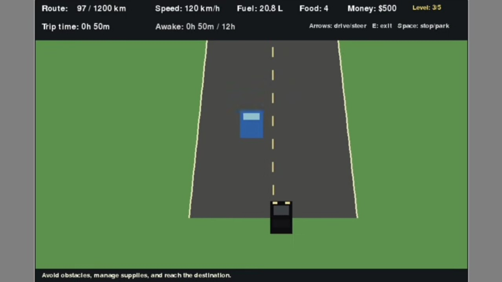
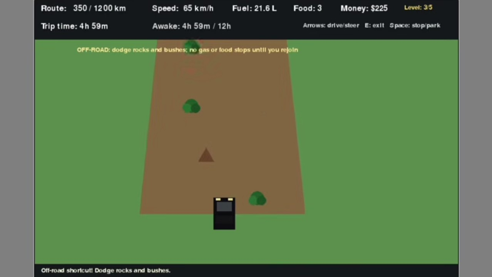

To install the game locally on any Operating system

Make sure python3 and pygame are installed on your pc.

python -m pip install --upgrade pip

python -m pip install pygame

cd docs

tar -zxf pickuptown.tar.gz

cd assets

python3 main.py

